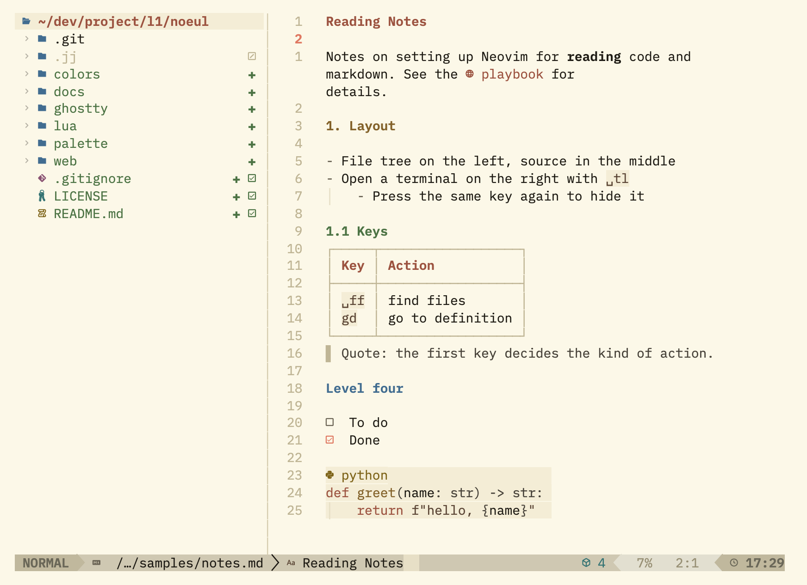
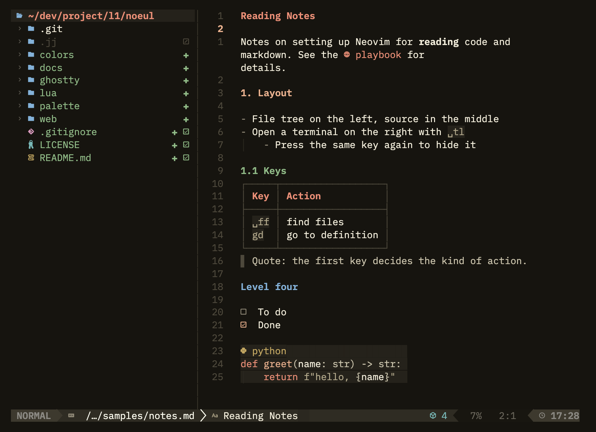
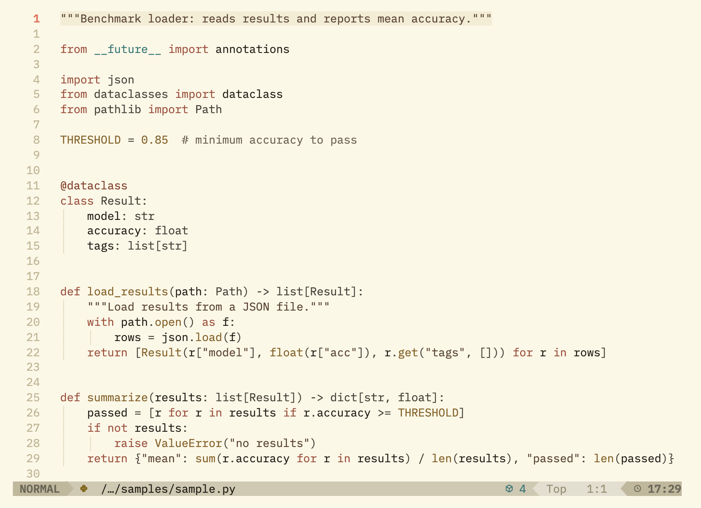
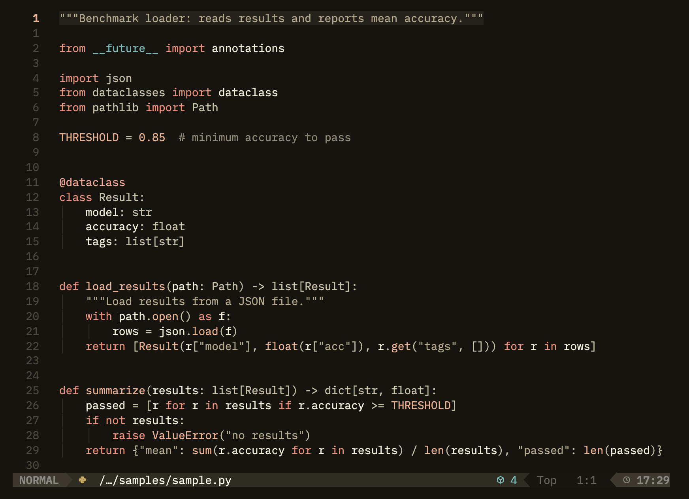
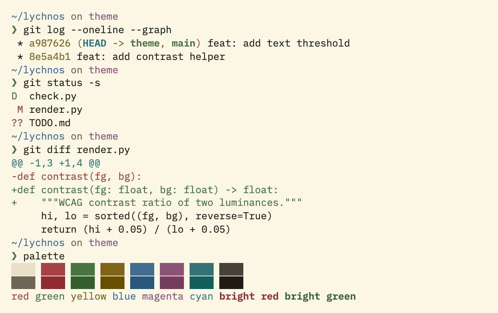
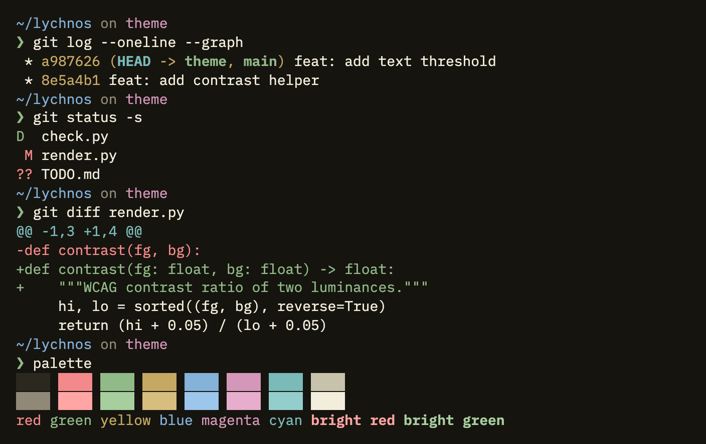
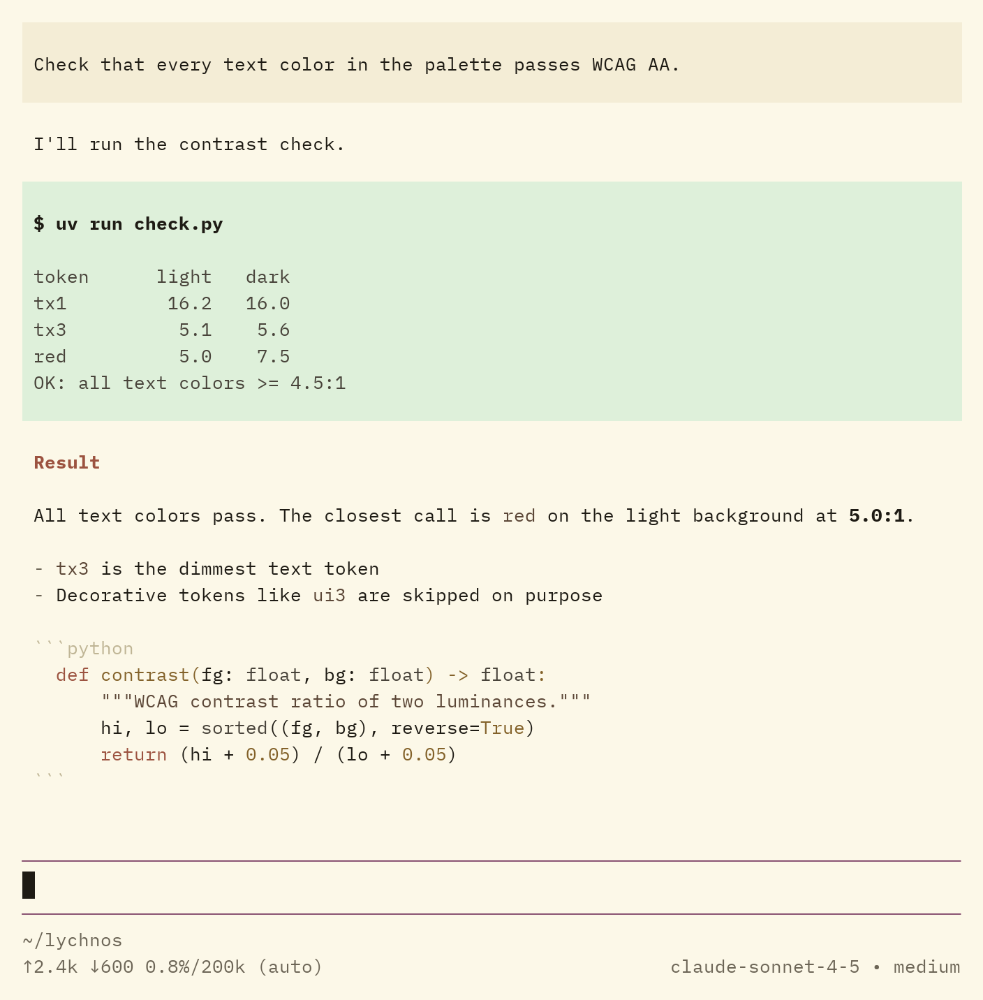
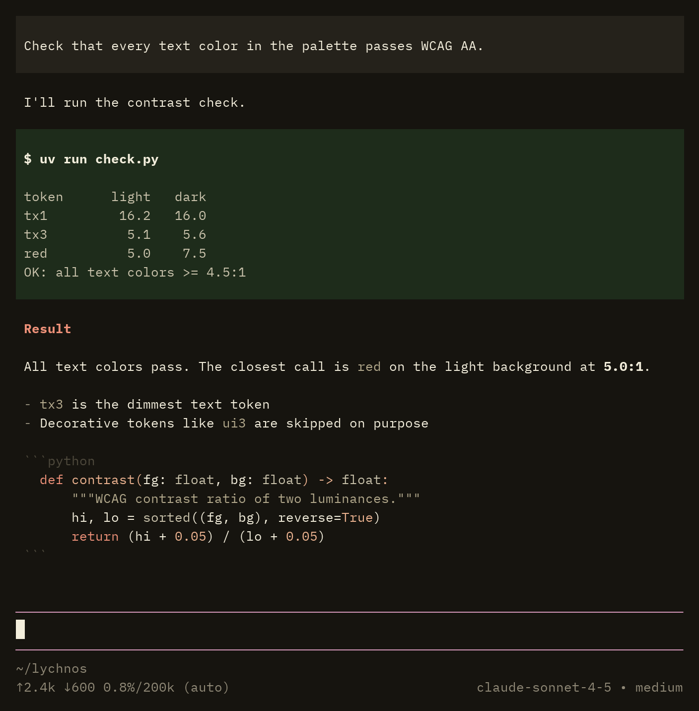
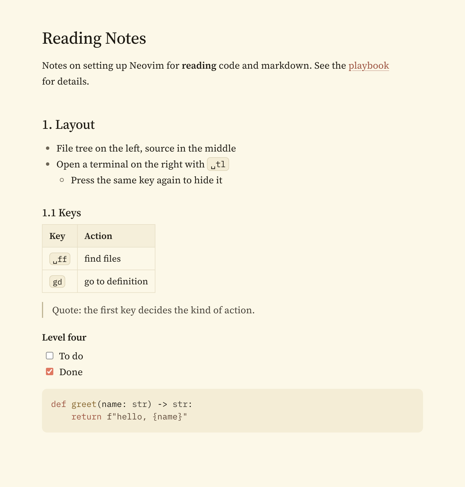
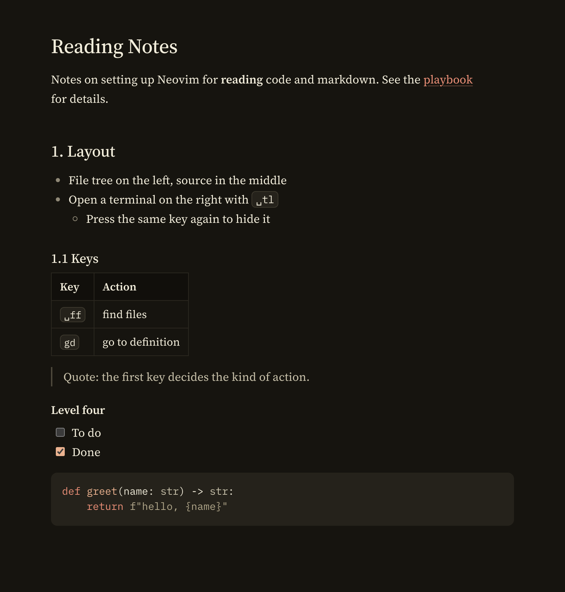

# Noeul

> A design system for Web, Ghostty, Neovim and pi

| | Light | Dark |
| --- | --- | --- |
| Neovim |  |  |
| Neovim (Python) |  |  |
| Ghostty |  |  |
| pi |  |  |
| Web |  |  |

## Changelog

- v1.0.0: Initial release

## Install

Neovim (0.10+, `termguicolors` required) with lazy.nvim:

```lua
{ "sejkimm/noeul", lazy = false, priority = 1000,
  config = function() vim.cmd.colorscheme("noeul") end }
```

With the built-in `vim.pack` (0.12+):

```lua
vim.pack.add({ "https://github.com/sejkimm/noeul" })
vim.cmd.colorscheme("noeul")
```

`noeul` follows `'background'`. `noeul-light` and `noeul-dark` pin one variant.

Ghostty:

```sh
mkdir -p ~/.config/ghostty/themes
cp ghostty/noeul-* ~/.config/ghostty/themes/
# in ~/.config/ghostty/config:
# theme = light:noeul-light,dark:noeul-dark
```

[pi](https://pi.dev):

```sh
mkdir -p ~/.pi/agent/themes
cp pi/noeul-*.json ~/.pi/agent/themes/
# in ~/.pi/agent/settings.json:
# "theme": "noeul-light/noeul-dark"
```

Web:

```html
<link rel="stylesheet" href="https://cdn.jsdelivr.net/gh/sejkimm/noeul@1/web/noeul.css">
<script src="https://cdn.jsdelivr.net/gh/sejkimm/noeul@1/web/noeul.js" defer></script>
```

`@1` follows the latest 1.x release. Use `@1.0.0` to pin one version.

`noeul.js` is optional. It highlights the table-of-contents link of the section being read.

The theme follows the OS. Force it with `<html data-theme="light|dark">`.

## License

- [Source Serif 4](https://github.com/adobe-fonts/source-serif) by Adobe, SIL Open Font License 1.1
- [IBM Plex Mono](https://github.com/IBM/plex) by IBM, SIL Open Font License 1.1
- [Pretendard](https://github.com/orioncactus/pretendard) by Kil Hyung-jin, SIL Open Font License 1.1
- Accent colors derived from the [Color Hunt palette](https://colorhunt.co/palette/fcf8e8d4e2d4ecb390df7861) #FCF8E8 #D4E2D4 #ECB390 #DF7861

Noeul is released under the [MIT License](LICENSE).
